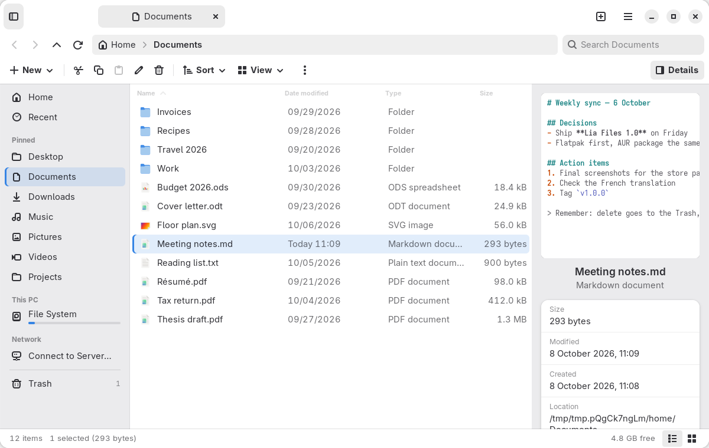

# Lia Files

A clean, modern file manager for Linux: a tidy command bar, a breadcrumb
address bar, tabs, a quiet sidebar and a details pane. Built with Rust,
GTK 4 and libadwaita.



## Install

- **Flatpak**: download `lia-files.flatpak` from the
  [latest release](https://github.com/TLia1/Lia-s-file-linux/releases/latest),
  then `flatpak install --user lia-files.flatpak`.
- **Arch Linux / CachyOS**: build `build-aux/PKGBUILD` with `makepkg -si`.

To make it the default file manager:
`xdg-mime default io.github.lia.Files.desktop inode/directory`.

To use Lia Files for other apps' **Choose File** and **Select Folder** dialogs,
install the native file chooser portal and select `lia` in your portal settings.
See [File chooser integration](docs/file-chooser.md) for setup, rollback and tests.

## Build from source

Needs Rust ≥ 1.88, GTK ≥ 4.20, libadwaita ≥ 1.8, GtkSourceView 5,
libarchive, Meson and blueprint-compiler.

```sh
cargo run                 # run uninstalled
make install              # meson setup build && ninja -C build install
```

Flatpak: `flatpak-builder --user --install --force-clean _flatpak build-aux/io.github.lia.Files.json`.

`make lint` and `make test` run the checks CI runs; [docs/qa.md](docs/qa.md)
has the manual checklist and the release steps. [PLAN.md](PLAN.md) describes
the design and architecture.

## Themes

Appearance preferences and watched user stylesheets let Lia Files follow desktop
themes, including Penumbra. See [Themes and desktop integration](docs/themes.md)
for tokens, text preview schemes, glass surfaces and custom context-menu actions.

## License

GPL-3.0-or-later.
